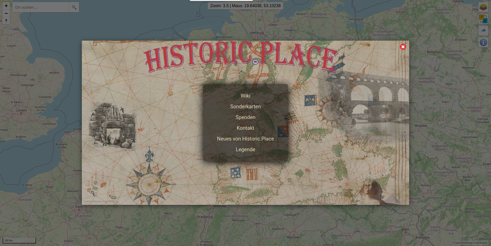

## Allgemeine Informationen
***
Kartenanwendung [Historic.Place](https://www.historic.place/) auf Basis von MapLibre.

* Anzeige von POIs mit Popup und Verlinkung zu weiteren Infos.
* Einblenden historischer Karten als Overlay.

### Grundlayer
***
* [OpenStreetMap](https://karte.openstreetmap.de/#map=5/51.5/11)
* [OpenTopoMap](https://opentopomap.org/about)

### Screenshot
***

### Technologien
***
* [Maplibre](https://maplibre.org/): Open-Source-Mapping-Bibliotheken
* [Javascript](https://de.wikipedia.org/wiki/JavaScript):  Skriptsprache
* [PHP](https://de.wikipedia.org/wiki/PHP): Skriptsprache
* [HTML](https://de.wikipedia.org/wiki/Hypertext_Markup_Language): Hypertext-Auszeichnungssprache
* [CSS](https://wiki.selfhtml.org/wiki/CSS): Formatierungssprache für HTML

Nutzt für die Suche:

* [Nominatim](https://nominatim.org/): Open-Source-Geokodierung mit OpenStreetMap-Daten

### Datenquellen
***
Für [POIs](https://de.wikipedia.org/wiki/Point_of_Interest):

* [OpenStreetMap](https://www.openstreetmap.org/about): Lizenz [ODBL](https://osmfoundation.org/wiki/Licence)

Nutzt Daten von:

* [Wikipedia](https://de.wikipedia.org/wiki/Wikipedia:Hauptseite): [Lizenz](https://de.wikipedia.org/wiki/Wikipedia:Lizenzbestimmungen)
* [Wikimedia Commons](https://commons.wikimedia.org/w/index.php?title=Main_Page&uselang=de): [Lizenzen](https://commons.wikimedia.org/wiki/Commons:Licensing/de)
* [Wikidata](https://www.wikidata.org/wiki/Wikidata:Main_Page): Lizenz [CC0](https://creativecommons.org/publicdomain/zero/1.0/deed.de)

### TODO
***
